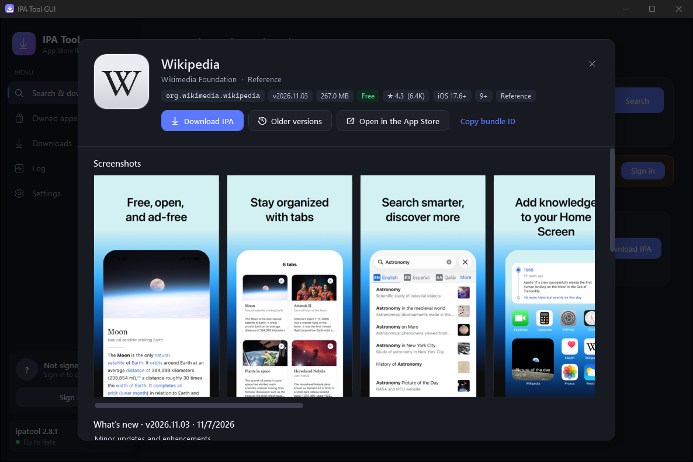
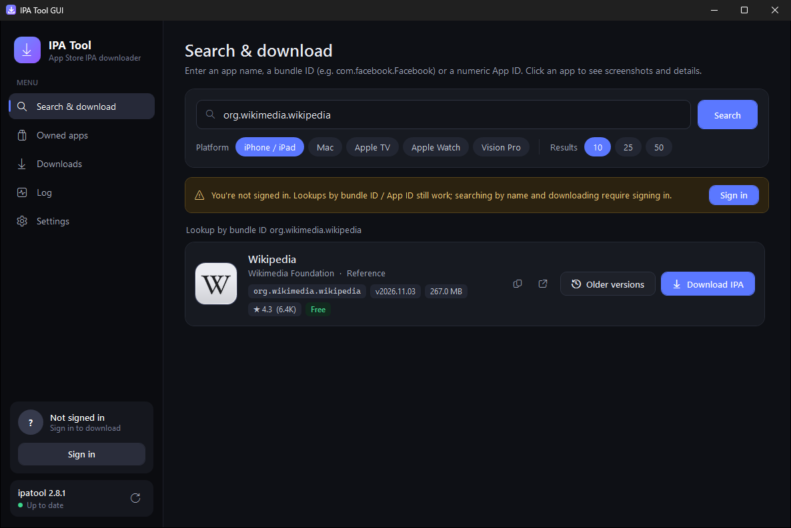
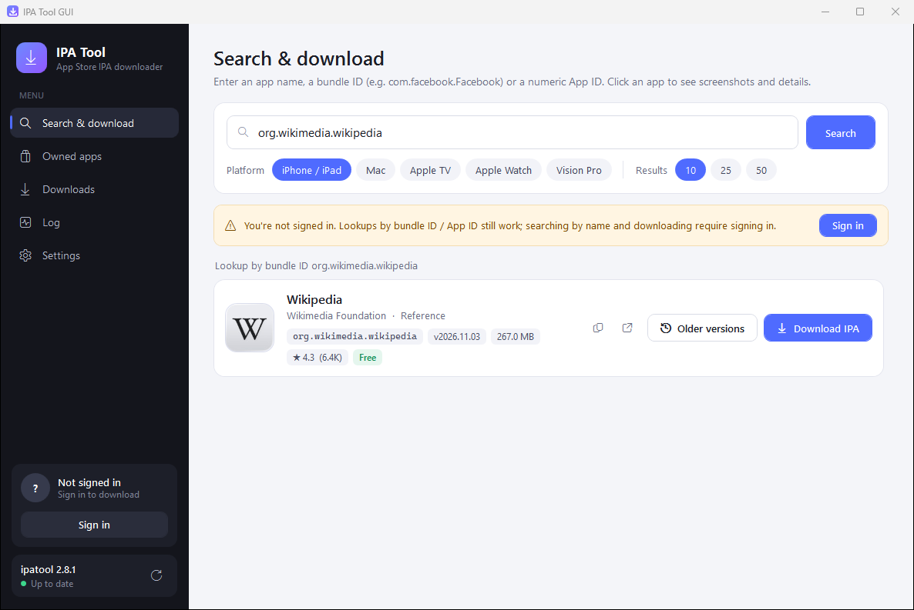
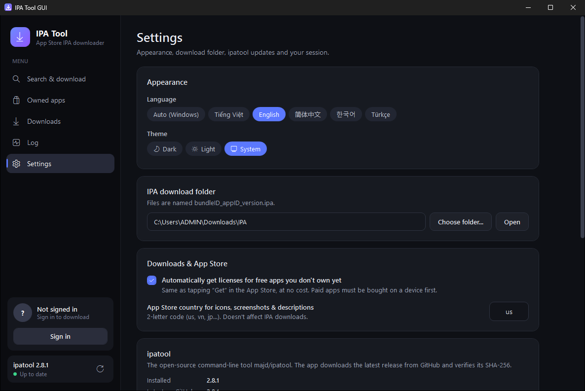
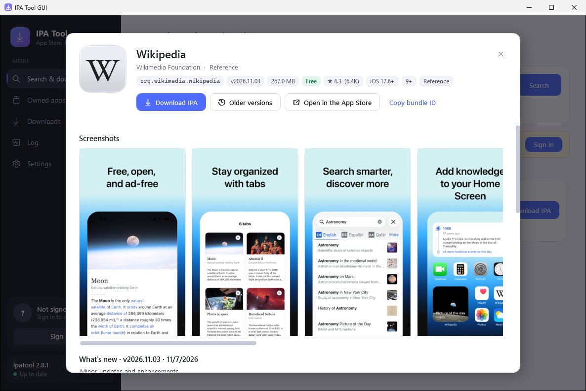
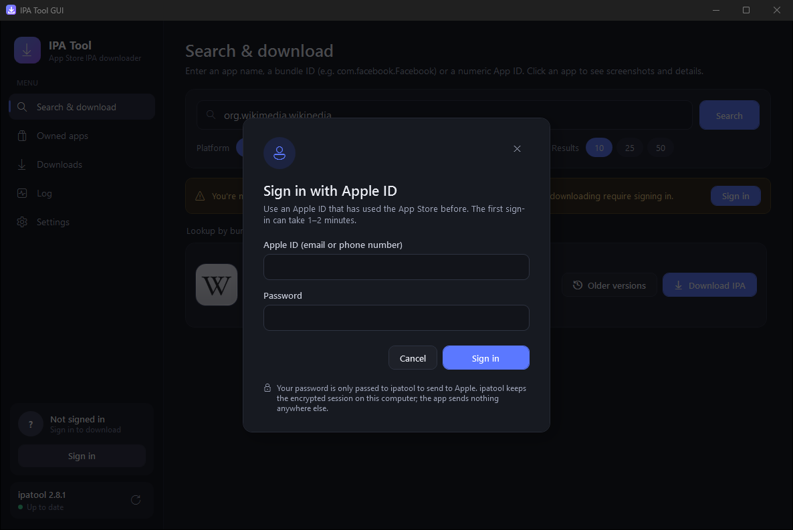
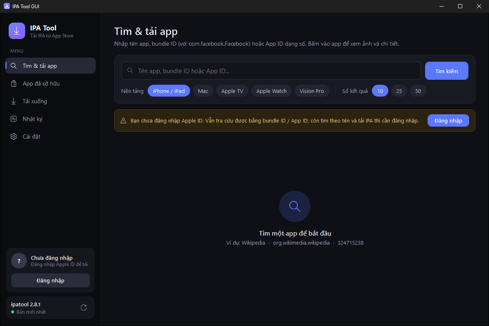

<p align="center">
  
</p>

<h1 align="center">IPA Tool GUI</h1>

<p align="center">
  A friendly Windows app for <a href="https://github.com/majd/ipatool">ipatool</a>: search, preview and download <b>IPA</b> files from the App Store with your own Apple ID. No commands to remember.
</p>

<p align="center">
  <b>English</b> · <a href="README.vi.md">Tiếng Việt</a>
</p>

<p align="center">
  <a href="https://github.com/DuyTaDinh/ipatool-gui/releases/latest"></a>
  <a href="https://github.com/DuyTaDinh/ipatool-gui/actions/workflows/build.yml"></a>
  
  
  <a href="LICENSE"></a>
</p>

<p align="center">
  <a href="https://github.com/DuyTaDinh/ipatool-gui/releases/latest/download/IpaToolGui.exe"><b>⬇ Download IpaToolGui.exe</b></a>
  &nbsp;·&nbsp;
  <a href="docs/INSTALL.md">Install &amp; usage guide</a>
  &nbsp;·&nbsp;
  <a href="CHANGELOG.md">Changelog</a>
</p>

<p align="center">
  
</p>

## Why?

[ipatool](https://github.com/majd/ipatool) is a great command-line tool for downloading IPAs. Using it, though, means remembering its syntax, updating it by hand whenever Apple changes how sign-in works, and figuring out what a "keychain passphrase" is. IPA Tool GUI puts all of that into one window:

- **Nothing to install.** A single `IpaToolGui.exe` (~330 KB) that runs on any Windows 10/11 PC, with no .NET, Python or Node needed.
- **Always the latest ipatool.** The app downloads the official build from GitHub, verifies its SHA-256 and keeps it updated.
- **Easy to use, in your language.** English, Tiếng Việt, 简体中文, 한국어 and Türkçe. Dark and light themes. Error messages tell you how to fix the problem instead of dumping raw errors.

## Features

| | |
|---|---|
| 🔎 **Search** | By name, **bundle ID** (`com.facebook.Facebook`) or **App ID** (`284882215`), for iPhone/iPad, Mac, Apple TV, Apple Watch and Vision Pro. |
| 🖼️ **App Store-style preview** | Icon, **screenshots**, description, what's new, rating, size, minimum OS, age rating and an **Open in the App Store** button. |
| ⬇️ **Download queue** | Progress bar, cancel, resume after an interruption, show the file in Explorer. |
| 🕘 **Older versions** | Lists every version Apple still has, resolves version numbers and release dates, and downloads exactly the one you pick. |
| 🛍️ **Owned apps** | Everything your Apple ID has downloaded or bought, including apps removed from the Store. |
| 🔐 **Apple ID sign-in** | Two-factor authentication supported. The session is encrypted and its key is protected with Windows DPAPI. |
| 🎟️ **Automatic licenses** | Free apps you don't own yet are "Get"-ed for you, like on the App Store. Paid apps are never bought. |
| 🌐 **5 languages** | Follows your Windows language automatically; switch at any time without restarting. |
| 🌗 **Dark / Light / System theme** | Follows Windows by default, including the window title bar. |
| 🔄 **Auto-update** | ipatool updates itself; the app tells you when a new IPA Tool GUI release is out. |
| 🧾 **Log** | Every ipatool command and its output, with passwords, 2FA codes and passphrases hidden. Handy for bug reports. |

## Screenshots

| Dark | Light |
|---|---|
|  |  |
|  |  |

<details>
<summary><b>Sign-in and other languages</b></summary>

| Sign in (with 2FA) | Tiếng Việt |
|---|---|
|  |  |
| **简体中文** | **한국어** |
|  |  |
| **Türkçe** | |
|  | |

</details>

## Quick start

1. Download [`IpaToolGui.exe`](https://github.com/DuyTaDinh/ipatool-gui/releases/latest/download/IpaToolGui.exe) and run it.
   If Windows SmartScreen warns you (the exe isn't code-signed yet), click **More info → Run anyway**.
2. On first launch the app downloads ipatool (~27 MB, a few seconds).
3. Click **Sign in**, enter your Apple ID and password, then the 2FA code if Apple asks for one.
4. Search for an app and click **Download IPA**. Files are saved to `Downloads\IPA`.

Step-by-step guide, uninstalling and troubleshooting: **[docs/INSTALL.md](docs/INSTALL.md)**.

### Requirements

- Windows 10 (1903 or later) or Windows 11, x64 or ARM64. .NET Framework 4.8 is already part of Windows.
- An Apple ID that has used the App Store before.
- Access to `github.com`, `itunes.apple.com` and Apple's App Store servers.

## FAQ

<details>
<summary><b>Sign-in fails with <code>HTTP 403</code> / <code>unexpected response from Apple</code></b></summary>

Usually an outdated ipatool: Apple changed its sign-in flow, and ipatool 2.8.0 and later handle the new one. Open **Settings → Check &amp; update**. If it still fails, wait a few minutes (Apple may block you briefly after several failed attempts) and try again.
</details>

<details>
<summary><b><code>license is required</code> when downloading</b></summary>

The Apple ID doesn't own the app yet. For free apps, turn on **Settings → Automatically get licenses**. Paid apps must be bought on an iPhone/Mac with that Apple ID first. This app never pays for anything.
</details>

<details>
<summary><b>"Not signed in" although I signed in with the ipatool CLI before</b></summary>

That session was encrypted with a different passphrase. Either sign in again (the old session is replaced), or enter your old passphrase in **Settings → Use another passphrase**.
</details>

<details>
<summary><b>Can I install the downloaded IPA?</b></summary>

App Store IPAs are encrypted (FairPlay) and tied to the Apple ID that downloaded them, so they install on devices **signed in with the same Apple ID**, for example via Apple Configurator. They are Apple's original builds, not cracked copies.
</details>

<details>
<summary><b>Why does SmartScreen warn me? Is the exe safe?</b></summary>

The exe isn't code-signed yet, and new unsigned files always trigger SmartScreen. Every release is built from this repository's source by GitHub Actions and ships with a SHA-256 checksum and a [build provenance attestation](https://docs.github.com/actions/security-for-github-actions/using-artifact-attestations), so you can check that the file you downloaded came from this repo's CI: see [docs/INSTALL.md](docs/INSTALL.md#2-download).
</details>

More: [docs/INSTALL.md#troubleshooting](docs/INSTALL.md#troubleshooting).

## Security & privacy

- Your password is only handed to `ipatool.exe` running on your PC. The app **doesn't store** it and **doesn't send** it anywhere else.
- ipatool keeps the session encrypted; the encryption key is random and protected with Windows DPAPI.
- The app only talks to GitHub (ipatool and update checks) and Apple (App Store, iTunes Lookup). No analytics, no telemetry.

Details and how to report a vulnerability: [SECURITY.md](SECURITY.md).

## Building from source

Requires the [.NET SDK 6+](https://dotnet.microsoft.com/download) on the build machine only:

```powershell
git clone https://github.com/DuyTaDinh/ipatool-gui.git
cd ipatool-gui
./build.ps1                 # → dist\IpaToolGui.exe
```

GitHub Actions builds every push. Pushing a `vX.Y.Z` tag publishes a release with `IpaToolGui.exe`, its `.sha256` and a provenance attestation.

```
src/IpaToolGui/
├─ MainWindow.xaml(.cs)   UI and app flow
├─ Languages/*.json       UI strings, one file per language
├─ Themes/                Colors.Dark/Light.xaml (palettes) + Theme.xaml (styles)
├─ Controls/Spinner       loading spinner
├─ Models/Models.cs       AppItem, DownloadJob, VersionItem
└─ Services/
   ├─ IpaTool.cs          runs ipatool (--format json) and parses its output
   ├─ Updater.cs          finds/downloads/verifies/installs ipatool; GUI update check
   ├─ Itunes.cs           icons, screenshots, descriptions from the iTunes Lookup API
   ├─ Loc.cs              localization + {l:Tr key} XAML markup extension
   ├─ ThemeManager.cs     dark/light/system theme, dark title bar
   ├─ FolderPicker.cs     modern Windows folder dialog
   └─ Common.cs           settings (DPAPI), JSON, friendly error messages
```

## Contributing

Issues and pull requests are welcome: bug fixes, UI polish, and especially **translations**.

- **Add or improve a language:** copy `src/IpaToolGui/Languages/en.json` to `<code>.json`, translate the values (keep `{0}`, `{1}` placeholders), then add the language to `Loc.Languages` in `Services/Loc.cs` and a pill in the Settings page of `MainWindow.xaml`.
- **Bug reports:** use the [Bug report](https://github.com/DuyTaDinh/ipatool-gui/issues/new/choose) template and attach the **Log** (never your password).
- **Problems in ipatool itself** (the CLI fails the same way): please report them at [majd/ipatool](https://github.com/majd/ipatool/issues).
- **Pull requests:** make sure `./build.ps1` succeeds, describe the change, and add a screenshot for UI changes.

## License & credits

- This project is released under the **[MIT License](LICENSE)**.
- [ipatool](https://github.com/majd/ipatool) © Majd Alfhaily, MIT License. ipatool is **not** bundled: the app downloads the official release at runtime. See [THIRD_PARTY_NOTICES.md](THIRD_PARTY_NOTICES.md).
- This project is **not affiliated with, endorsed or sponsored by** Apple Inc. Apple, App Store, Apple ID, iPhone, iPad and Mac are trademarks of Apple Inc.
- Only download apps your Apple ID is entitled to (free or purchased), in line with Apple's terms. The authors aren't responsible for misuse.
