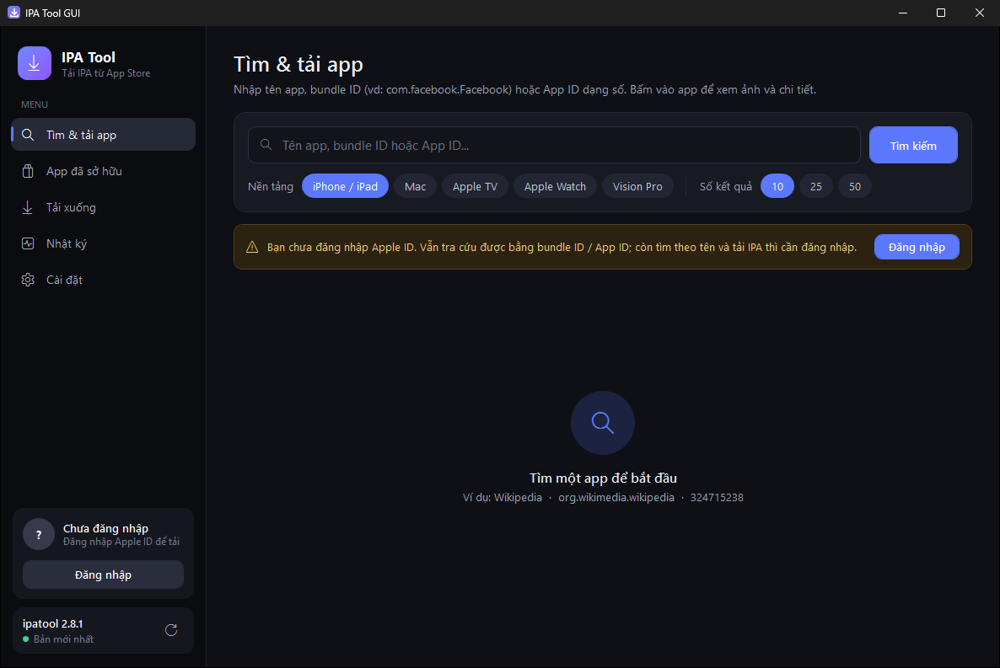
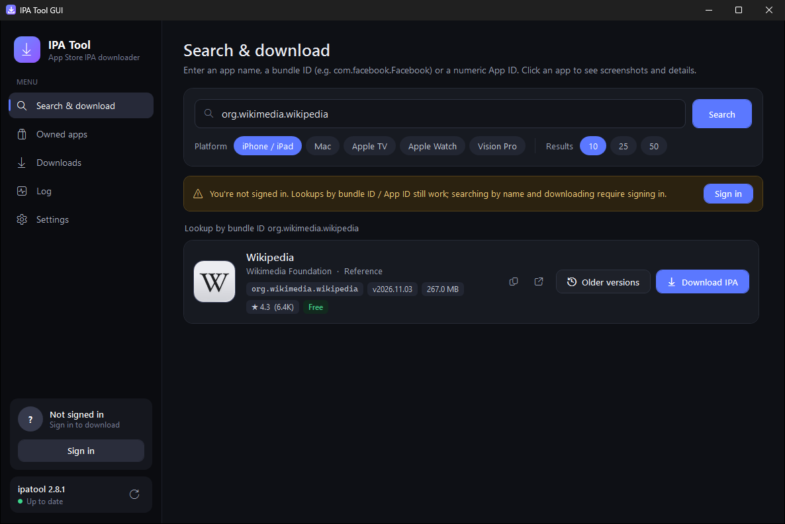
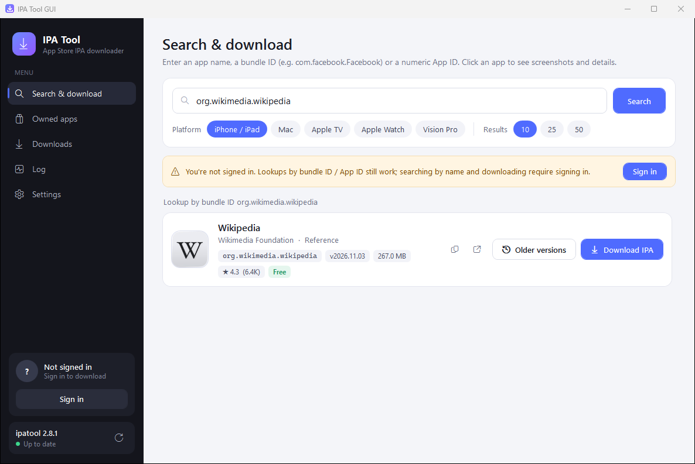
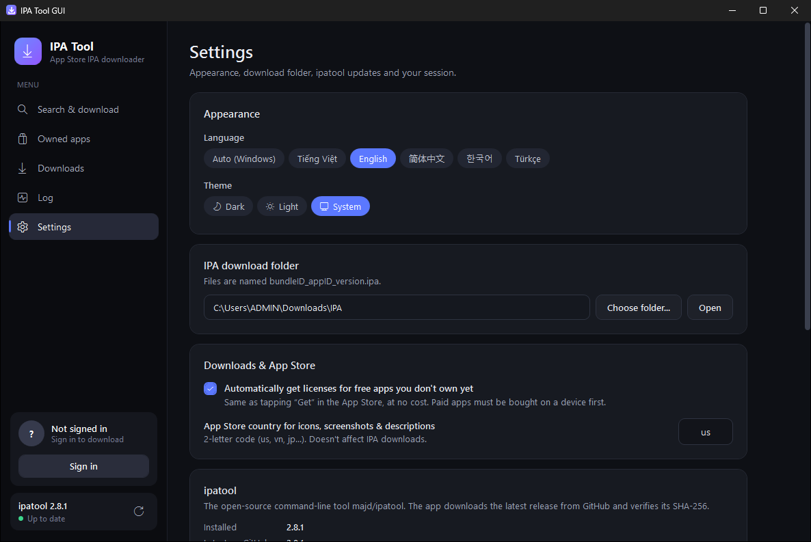
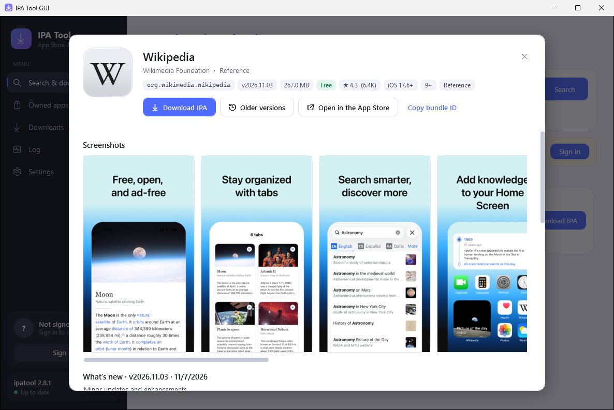

  

<h1 align="center">IPA Tool GUI</h1>

  Giao diện Windows cho <a href="https://github.com/majd/ipatool">ipatool</a>: tìm, xem trước và tải file <b>IPA</b> từ App Store bằng Apple ID của bạn. Không phải nhớ câu lệnh nào.

  <a href="README.md">English</a> · <b>Tiếng Việt</b>

  <a href="https://github.com/DuyTaDinh/ipatool-gui/releases/latest/download/IpaToolGui.exe"><b>⬇ Tải IpaToolGui.exe</b></a>
  &nbsp;·&nbsp;
  <a href="docs/INSTALL.vi.md">Hướng dẫn cài đặt &amp; sử dụng</a>
  &nbsp;·&nbsp;
  <a href="CHANGELOG.md">Có gì mới</a>

  

## Vì sao có dự án này?

[ipatool](https://github.com/majd/ipatool) là công cụ dòng lệnh rất tốt để tải IPA, nhưng muốn dùng thì phải nhớ cú pháp, tự cập nhật mỗi khi Apple đổi cách đăng nhập, và phải hiểu "keychain passphrase" là gì. IPA Tool GUI gói tất cả vào một cửa sổ:

- **Không cần cài đặt.** Chỉ 1 file `IpaToolGui.exe` (~330 KB), chạy trên mọi máy Windows 10/11, không cần .NET, Python hay Node.
- **Luôn dùng ipatool mới nhất.** App tự tải bản chính thức từ GitHub, kiểm tra SHA-256 và tự cập nhật.
- **Dễ dùng, đúng ngôn ngữ của bạn.** Có Tiếng Việt, English, 简体中文, 한국어 và Türkçe, giao diện Tối/Sáng. Thông báo lỗi kèm hướng dẫn cách sửa.

## Tính năng

| | |
|---|---|
| 🔎 **Tìm app** | Theo tên, **bundle ID** (`com.facebook.Facebook`) hoặc **App ID** (`284882215`). Lọc iPhone/iPad, Mac, Apple TV, Apple Watch, Vision Pro. |
| 🖼️ **Xem trước như App Store** | Icon, **ảnh chụp màn hình**, mô tả, "Có gì mới", rating, dung lượng, iOS tối thiểu, nút **Mở trên App Store**. |
| ⬇️ **Hàng đợi tải** | Thanh tiến độ, hủy, tải tiếp phần dở, mở thư mục chứa file. |
| 🕘 **Phiên bản cũ** | Liệt kê mọi phiên bản Apple còn lưu, xem số phiên bản và ngày phát hành, tải đúng bản cần. |
| 🛍️ **App đã sở hữu** | Danh sách app Apple ID đã tải/mua, kể cả app đã bị gỡ khỏi Store. |
| 🔐 **Đăng nhập Apple ID** | Hỗ trợ xác thực 2 bước. Phiên được mã hóa, khóa cất bằng Windows DPAPI. |
| 🎟️ **Tự nhận license** | App miễn phí chưa sở hữu được tự "Nhận" như trên App Store. Không bao giờ mua app trả phí. |
| 🌐 **5 ngôn ngữ** | Tự theo ngôn ngữ Windows; đổi bất kỳ lúc nào, không cần khởi động lại. |
| 🌗 **Tối / Sáng / Theo hệ thống** | Mặc định theo Windows, đổi theo cả thanh tiêu đề cửa sổ. |
| 🔄 **Tự cập nhật** | ipatool tự cập nhật; app báo khi có bản IPA Tool GUI mới. |
| 🧾 **Nhật ký** | Mọi lệnh ipatool đã chạy, với mật khẩu, mã 2FA và passphrase được ẩn. |

## Ảnh chụp màn hình

| Tối | Sáng |
|---|---|
|  |  |
|  |  |

## Bắt đầu nhanh

1. Tải [`IpaToolGui.exe`](https://github.com/DuyTaDinh/ipatool-gui/releases/latest/download/IpaToolGui.exe) rồi chạy.
   Nếu Windows SmartScreen cảnh báo (exe chưa ký số): **More info → Run anyway**.
2. Lần đầu, app tự tải ipatool (~27 MB, vài giây).
3. Bấm **Đăng nhập**, nhập Apple ID và mật khẩu, rồi mã 2FA nếu Apple hỏi.
4. Tìm app, bấm **Tải IPA**. File được lưu ở `Downloads\IPA`.
5. Đổi ngôn ngữ và giao diện ở **Cài đặt → Giao diện**.

Hướng dẫn chi tiết, gỡ cài đặt và xử lý lỗi: **[docs/INSTALL.vi.md](docs/INSTALL.vi.md)**.

**Yêu cầu:** Windows 10 (1903 trở lên) hoặc Windows 11, x64/ARM64; Apple ID đã từng dùng App Store; truy cập được GitHub và máy chủ Apple.

## Câu hỏi thường gặp

<b>Đăng nhập bị lỗi <code>HTTP 403</code> / <code>unexpected response from Apple</code></b>

Thường do dùng ipatool cũ: Apple đổi cách đăng nhập, ipatool 2.8.0 trở lên đã sửa. Vào **Cài đặt → Kiểm tra &amp; cập nhật**. Nếu vẫn lỗi, đợi vài phút rồi thử lại.

<b><code>license is required</code> khi tải</b>

Apple ID chưa sở hữu app. Với app miễn phí, bật **Cài đặt → Tự nhận license**. Với app trả phí, phải mua trên iPhone/Mac bằng Apple ID đó trước.

<b>Báo "Chưa đăng nhập" dù trước đây đã đăng nhập ipatool CLI</b>

Phiên cũ được mã hóa bằng passphrase khác. Bạn có thể đăng nhập lại, hoặc nhập passphrase cũ ở **Cài đặt → Dùng passphrase khác**.

<b>Vì sao SmartScreen cảnh báo? File exe có an toàn không?</b>

File exe chưa được ký số, nên SmartScreen luôn cảnh báo với file mới. Mỗi bản phát hành đều được GitHub Actions build từ mã nguồn trong repo này, kèm SHA-256 và *build provenance attestation*. Nhờ đó bạn kiểm chứng được file tải về đúng là do CI của repo này build ra: xem [docs/INSTALL.vi.md](docs/INSTALL.vi.md#2-tải-về).

## Bảo mật & quyền riêng tư

Mật khẩu chỉ được chuyển cho `ipatool.exe` chạy trên máy bạn. App không lưu và không gửi mật khẩu đi đâu khác. Phiên do ipatool mã hóa; khóa ngẫu nhiên được cất bằng Windows DPAPI. App không có analytics hay telemetry. Chi tiết: [SECURITY.md](SECURITY.md).

## Build & đóng góp

Xem phần [Building from source](README.md#building-from-source) và [Contributing](README.md#contributing). Rất hoan nghênh đóng góp bản dịch: chép file `src/IpaToolGui/Languages/en.json` rồi dịch.

## Giấy phép & ghi nhận

- Mã nguồn phát hành theo giấy phép **[MIT](LICENSE)**.
- [ipatool](https://github.com/majd/ipatool) © Majd Alfhaily, giấy phép MIT. App không đóng gói kèm ipatool mà tải bản chính thức khi chạy. Xem [THIRD_PARTY_NOTICES.md](THIRD_PARTY_NOTICES.md).
- Dự án **không liên kết, không được bảo trợ** bởi Apple Inc. Apple, App Store, Apple ID là thương hiệu của Apple Inc.
- Chỉ dùng để tải app mà Apple ID của bạn có quyền tải (miễn phí hoặc đã mua).
